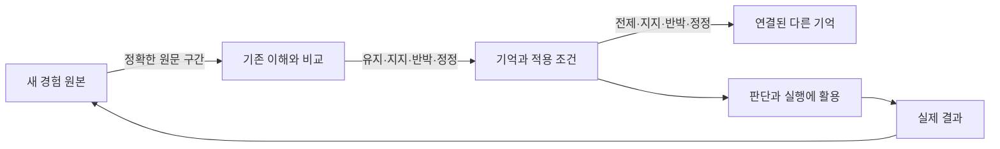

# Grounded Memory Architecture (GMA)

**경험을 보존하고, 경험으로 현재 이해를 바꾸는 기억 관리 아키텍처.**

문서가 늘어날수록 다시 읽어야 할 양도 늘어나는 문제를 해결한다. 원문은 당시 경험의 이력으로 남긴다. 반복해서 활용할 의미는 기억으로 만들고, 기억 사이에 근거·반례·전제·정정 관계를 연결한다. 새 경험이 들어오면 문서 하나를 더 쌓는 데서 끝내지 않고 기존 이해와 그 이해에 의존한 절차까지 갱신한다.

공개 주소: [replex-me/grounded-memory-architecture](https://github.com/replex-me/grounded-memory-architecture). 아파치 2.0 라이선스의 아키텍처·명세·참조 구현이다. 현재는 **공개 초안**이며 외부 표준기구가 승인한 표준은 아니다.

## 무엇이 달라지는가

가령 위키에 “이 절차를 쓰면 문제를 해결할 수 있다”는 판단이 있다. 성공 보고서가 들어오면 같은 판단에 근거를 연결한다. 같은 보고서의 요약을 다시 읽었다고 근거가 두 배가 되지는 않는다. 새로운 실패가 들어오면 실패 원문을 보존하고 판단과 관련 절차를 재검토한다. 실패가 입력 조건의 차이 때문이라면 “필요한 입력이 있는 경우에 유효하다”로 판단을 고치고 절차에도 입력 확인을 추가한다.

바뀌는 것은 단순한 점수 하나가 아니다. **기억의 문장, 적용 조건, 근거의 구성, 의존 관계, 검토 상태**가 함께 바뀐다. 어떤 경험 때문에 바뀌었는지도 남는다. 문서를 많이 읽거나 기억을 많이 사용했다는 사실은 그 판단이 맞다는 근거와 별도로 기록한다.

미션·원칙·결정·관찰·가설·절차·질문도 같은 구조 안에서 관리할 수 있다. 실패한 실행이 조직의 미션을 자동으로 폐기하는 일은 없다. 경험에 의한 판단 수정과 권한에 따른 방향 채택을 구별한다.

## 가장 작은 구조

| 구성 | 남기는 것 | 갱신 방식 |
| --- | --- | --- |
| 경험 원본 | 보고서·대화·관측의 당시 내용과 출처 | 본문을 덮어쓰지 않고 새 버전 보존 |
| 기억 | 다시 사용할 의미와 조건·예외 | 같은 의미는 유지하고 근거 추가, 의미가 달라지면 정정 |
| 관계 | 출처, 지지, 반박, 전제, 정정, 탐색 | 역할과 근거를 기록하고 잘못된 연결은 철회 |
| 변경 이력 | 무엇을 읽고 왜 무엇을 바꿨는지 | 기억·관계·영향 상태와 함께 저장 |

구간 처리 목록은 읽지 않은 자료를 빠뜨리지 않기 위한 관리 장치다. 사용 기록은 활용 결과를 돌아보기 위한 장치다. 둘을 별도의 새로운 지식 원본으로 삼지 않는다.



원본끼리는 그래프 관계를 만들지 않는다. 원본과 기억은 직접 출처 연결로, 기억 내부는 위키형 관계망으로 관리한다. 하이퍼링크는 이 관계를 읽고 이동하는 화면 표현이다. 하이퍼링크만으로 지지와 반박의 차이나 전제 변경의 영향을 표현할 수는 없으므로 관계의 역할도 저장한다.

## 바로 확인하기

Node.js 22.16 이상이면 키·모델·서버 없이 실행할 수 있다. 합성 원자료를 임시 SQLite에 저장하고 끝나면 제거한다.

```bash
git clone https://github.com/replex-me/grounded-memory-architecture.git
cd grounded-memory-architecture
node examples/persistent-demo.mjs --explain
```

여덟 단계가 실제 저장소에서 실행된다. 첫 성공 → 같은 사건의 재인용 → 독립 성공 → 사용 기록 → 반례 → 조건과 절차 정정 → 재검토 → 재시작이다. 재인용은 지지 수를 늘리지 않고 사용은 성공 근거로 계산되지 않는다. 반례는 의존 절차도 재검토하게 한다. 정정 뒤에는 관련 근거를 다시 판별하며 이전 반례와 변경 원인은 보존한다. 각 결과는 예제 안의 단언으로 검사한다.

구조화된 결과는 다음 명령으로 확인한다.

```bash
node examples/persistent-demo.mjs
node --test runtime/*.test.mjs
```

전체 명세·참조 검사에는 Python 3.10 이상이 필요하다.

```bash
python3 -m venv .venv
.venv/bin/python -m pip install -r requirements-test.txt
.venv/bin/python tools/check.py
```

## 설계와 구현을 이해하는 순서

1. [아키텍처 설명](docs/architecture.md): 왜 이 구조인지, 관계의 뜻, 강화·약화·정정과 운영 책임.
2. [완전한 갱신 예제](docs/walkthrough.md): 단계별 실제 변화와 API 호출, 반례를 지우지 않는 정정.
3. [비교와 품질 검토](research/quality-review.md): 가까운 구현과 겹치는 부분, 현재 부족한 부분과 검증 기준.
4. [핵심 명세](spec/model.md), [시스템 구조](spec/system.md), [교환 지침](spec/interoperability.md): 구현이 지켜야 할 계약.
5. [영속 코어](runtime/README.md), [모델 스키마](schema/model.schema.json), [영속 변경 스키마](schema/runtime-change.schema.json).
6. [연구 근거](research/assessment.md), [평가 설계](spec/evaluation.md), [검증 기록](VALIDATION.md).

## 현재 구현의 범위

공개 코어는 원문 보존, 의미·조건·관계 갱신, 독립 사건 집계, 간접 영향 전파, 실제 읽은 버전의 충돌 확인, 거래 실패 복구, 요청 중복 방지, 변경 이력, 문자 검색과 그래프 회상을 구현한다. SQLite와 Node.js의 내장 기능을 사용하며 실행 의존성을 추가하지 않는다. 작은 단일 호스트부터 운영할 수 있다.

사람이나 에이전트가 원문과 현재 기억을 읽고 의미 변경안을 만든다. 코어가 문장의 참을 판단하거나 새 반례를 자동 발견하지는 않는다. 입력 수집·의미 판단·검토·저장은 서로 다른 책임이다. AI 모델이나 특정 위키를 강제하지 않으며 적용 환경이 인증·접근 권한·채택 권한을 맡는다.

공개 Python 참조 검사기와 영속 코어는 같은 기본 기록을 사용하지만 변경·검토 토큰 프로파일이 다르다. 독립 구현 간 전체 상태 교환은 아직 검증하지 않았다. 저장소 이름을 바꾸면서 기존 형식 식별자와 토큰을 바꾸지는 않는다.

원자료 등록이나 합성 검사 통과를 전체 지식 검토, 사용자의 판단 개선, 다른 시스템보다 높은 성능의 증거로 보고하지 않는다. 공개 구현의 미연결 반례 발견·독립 교환·업무 비교 평가 상태는 [품질 검토](research/quality-review.md)에 기록한다. 실제 조직의 자료와 적용 작업 현황은 각 조직의 비공개 환경에서 관리한다.

## 기여와 공개 이용

의미를 잃는 반례, 조건이 달라지는 사례, 독립 구현과 교환 결과, 재현 가능한 평가를 환영한다. [기여 절차](CONTRIBUTING.md)와 [보안 안내](SECURITY.md)를 따른다. 공개 예제에는 합성 자료만 사용하며 회사 원문·운영 DB·인증정보를 포함하지 않는다.
