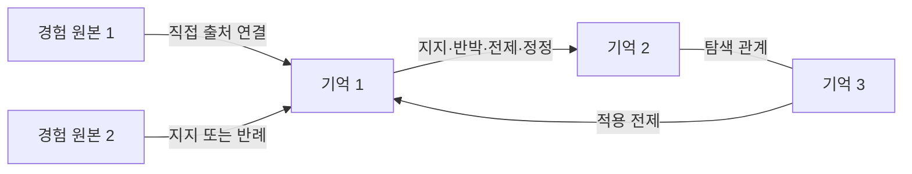

# 경험 기반 기억 관리 아키텍처

경험 기록에서 기억을 형성하고, 기억 사이의 관계와 근거를 따라 현재 이해를 갱신하는 공개 아키텍처 초안이다. 프로그램의 브랜드나 데이터 형식만을 제안하는 저장소가 아니다. 원리, 갱신 규칙, 교환 명세, 적합성 예제를 함께 제공한다. 고유 명칭은 아직 확정하지 않았다.

**원본은 경험의 이력으로 남기고, 현재 이해는 기억과 관계로 갱신한다.**

새 보고서 하나를 새로운 현재 지식 문서 하나로 등록하는 대신, 기존 기억을 지지·반박·정정하는 부분을 연결하고 필요한 새 기억만 만든다. 기억은 조건과 예외가 온전한 문장·문단·절차다. 문서 길이나 작성 시점이 지식의 경계를 결정하지 않는다.



원본끼리는 그래프 관계를 만들지 않는다. 원본↔기억은 출처와 맥락을 되짚는 직접 연결이고, 기억↔기억은 위키처럼 탐색하는 장기기억 연결망이다. 같은 경험의 재인용은 별도 독립 근거가 아니다. 전제 변경은 관련 판단의 재검토로 이어지며 조회량을 믿음의 정확성으로 바꾸지 않는다.

## 읽는 순서

- [연구 판단과 비교](research/assessment.md): 수준, 5번의 왜, 기억·지식·관계, 최신 접근과 반대 근거.
- [핵심 명세](spec/model.md): 기록, 관계, 상태, 근거 집계, 갱신과 검토 최신성.
- [교환과 구현 지침](spec/interoperability.md): 기존 표준 대응, 토큰, 국소 조회와 저장.
- [평가 계획](spec/evaluation.md): 합성 검사와 실제 위키 비교, 안정화 관문.
- [데이터 스키마](schema/model.schema.json)와 [변경 스키마](schema/change.schema.json).
- [합성 예제](examples/snapshot.json), [참조 검사·전이](reference/model.py), [적합성 검사](tests/test_model.py).
- [영속 실행 코어](runtime/README.md): 국소 충돌·거래·재시작·변경 이력·의미 갱신·그래프 회상.
- [실제 시스템 구조](spec/system.md): 위키 어댑터와 전체 원문 구간의 처리.

## 실행

Python 3.10 이상과 검증 의존성 하나가 필요하다. 실제 문서·DB·AI 키·클라우드가 필요하지 않다.

```bash
python3 -m venv .venv
.venv/bin/python -m pip install -r requirements-test.txt
.venv/bin/python -m unittest discover -s tests -v
.venv/bin/python reference/model.py examples/snapshot.json
.venv/bin/python -m examples.demo
```

검사기는 형식뿐 아니라 금지된 원본 간 연결, 해시·인용 구간, 조건, 중복 사건, 반례, 철회, 간접 영향과 검토 최신성을 검사한다. 실행 예제에서 같은 시험의 요약을 넣어도 지지 사건 수가 늘지 않으며 새 반례가 들어오면 관련 기억과 절차가 재검토 상태로 바뀐다.

## 범위와 현재 검증

상태는 **공개 초안 0.1**이다. 생물학적 단기·장기기억의 재현, 인지 전체의 설명, 국제 표준 승인, 다른 접근보다 높은 성능을 주장하지 않는다. 입력 기록과 기억의 이분법, 원본끼리 연결하지 않는 경계는 업무용 관리 선택이다.

참조 전이는 메모리 내 함수로, 실패 시 입력 객체를 바꾸지 않고 성공 결과를 반환한다. DB의 영속성·인증·권한·복구나 실제 위키의 의미 정확성을 검증하지 않는다. 안정화에는 외부 독립 구현의 교환과 실제 전체 입력 평가가 필요하다. 세부 검증은 [검증 기록](VALIDATION.md)을 따른다.

특정 DB, AI 모델, 자동 추출, 벡터 검색, 웹 화면을 강제하지 않는다. 화면의 하이퍼링크는 구조화된 관계에서 파생한다. 공개 배포 자료에는 합성 예제만 포함한다.

## 공개 이용과 기여

아파치 2.0 라이선스다. 근거 있는 반례, 다른 구현의 교환 결과, 관계 확장의 의미와 전이 사례를 환영한다. 변경 제안은 [기여 절차](CONTRIBUTING.md)를 따른다. 보안과 공개 데이터의 경계는 [보안 안내](SECURITY.md)를 따른다.
