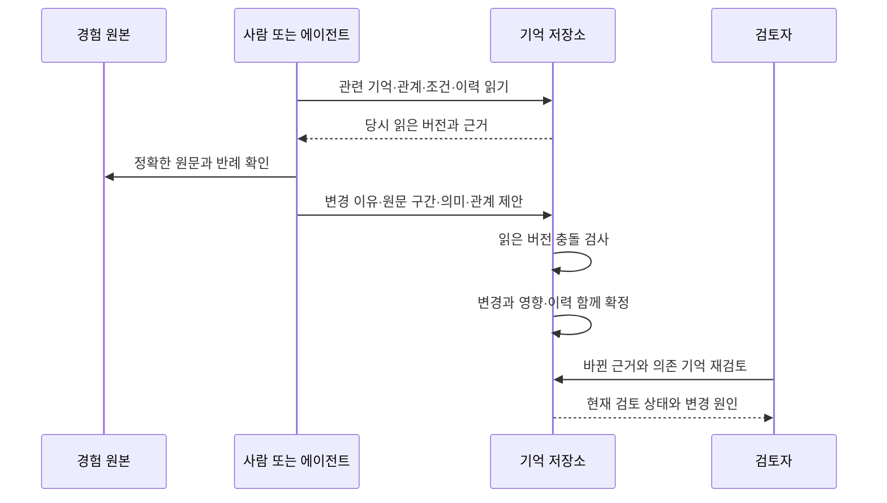

# 경험으로 현재 이해를 갱신하는 구조

## 설계의 출발점

위키의 목적은 문서 수집이 아니라 다음 판단에 필요한 현재 이해를 제공하는 것이다. 원본만 남기면 다음 사람은 과거 기록을 다시 읽고 판단을 재구성해야 한다. 요약만 남기면 조건과 반례, 어떤 경험에서 나온 판단인지 잃을 수 있다. 그래서 경험과 현재 이해를 분리하되 정확한 출처로 연결한다.

기억은 다시 활용할 의미다. 지식은 그 의미를 근거와 조건에 비추어 현재 사용할 수 있다고 판단한 이해다. 관계는 두 기억이 서로 어떤 역할을 하는지다. 이 정의는 업무용 설계의 기준이며 인간 기억의 유일한 과학적 정의가 아니다.

가장 작은 표현은 원본·기억·관계·변경이다. 기억에는 문장이나 문단·절차가 들어간다. 조건과 예외가 함께 이해되어야 하면 함께 둔다. 모든 문장을 노드로 쪼개거나 원래 문서 하나를 기억 하나로 복사하지 않는다. 원문 내용의 위치와 해시는 구조화하며 자연어 관계 설명을 해석하는 것만으로 갱신을 결정하지 않는다.

## 문서와 기억의 경계

회의록에 고객 문제, 가격 가설, 실행 결정이 함께 있어도 세 의미의 갱신 이유는 다를 수 있다. 가격이 틀렸다고 고객 문제까지 폐기할 필요는 없다. 이 경우 별도 기억을 만들고 정확한 원문 구간을 각각 연결한다. 반대로 긴 절차의 선행 조건·분기·예외가 떼어지면 사용할 수 없을 때는 하나의 완결된 기억으로 유지한다.

별도 기억을 만드는 기준은 글자 수나 문장 수가 아니라 **독립적으로 변경하거나 다시 사용할 수 있는 의미인가**다. 원문 구간 처리 목록에는 무엇을 반영했는지, 근거로만 남겼는지, 보류했는지와 이유를 남긴다. 일부 의미를 연결했다고 그 원문 전체를 검토 완료로 표시하지 않는다.

## 관계는 무엇을 뜻하는가

| 관계 | 의미 | 변경이 전파되는 방향 |
| --- | --- | --- |
| 출처·맥락 | 기억을 이해하는 데 필요한 원자료 | 관련 기억을 재검토 |
| 지지 | 이 조건의 경험·판단이 대상 판단을 뒷받침 | 지지받는 기억과 그 의존 기억 |
| 반박 | 이 조건의 경험·판단이 대상 판단과 충돌 | 반박받는 기억과 그 의존 기억 |
| 전제 | 이 기억을 사용하려면 다른 기억이 유효해야 함 | 전제에서 의존 기억으로 |
| 정정 | 새 의미가 이전 의미를 수정하거나 대체함 | 정정 대상의 검토와 사용 상태 |
| 탐색 | 함께 읽으면 도움이 됨 | 신뢰나 검토를 자동 전파하지 않음 |

관계도 판단이므로 틀릴 수 있다. 같은 단어가 나온다고 지지 관계를 만들지 않는다. 지지·반박에는 정확한 원문 구간, 조건, 판단 이유가 필요하다. 관계가 틀렸으면 철회하고 원문을 지우지 않는다. 관계의 방향은 저장된 역할에 따라 해석하며 무방향 하이퍼링크와 혼용하지 않는다.

## 강화와 약화에서 무엇이 바뀌는가

| 새 경험 | 적절한 변화 | 피해야 할 변화 |
| --- | --- | --- |
| 같은 사건의 재인용 | 출처는 추가하되 독립 사건 수 유지 | 반복 횟수를 신뢰로 계산 |
| 같은 조건의 독립 성공 | 지지 집단 추가, 관련 기억 재검토 | 성공 하나로 보편적 주장 확정 |
| 같은 조건의 독립 실패 | 반박 집단 추가, 의존 기억 재검토 | 조회량이 많으니 반례 무시 |
| 다른 조건의 결과 | 적용 가능성을 검토하고 조건 분리 | 무조건 성공·실패 수에 합산 |
| 원문 오류 확인 | 새 원문·근거 교체·영향 검토 | 과거 본문 덮어쓰기 |
| 절차 실패 | 수단과 전제를 조사 | 미션·원칙 자동 폐기 |
| 기억 사용 | 사용 사건 기록 | 사용을 성공 근거로 합산 |

현재 구현은 독립 사건 집단·상충 집단·사용 수·검토 상태·질문 관련성을 각각 제공한다. 독립성이나 시점이 확인되지 않으면 미확인이다. 지지 두 건·반박 한 건을 곧바로 신뢰도 67%라고 부르지 않는다. 사건 집단 수는 표본의 선정·측정 신뢰성이나 효과 크기를 반영하지 못한다. 보정된 신뢰도와 효과 추정은 측정 기준과 대표 표본이 있는 적용 환경에서 따로 정의하고 평가해야 한다.

이때 약화는 숫자 감소만을 뜻하지 않는다. 조건 축소, 전제 철회, 재검토 전환, 판단 대체가 더 적절할 수 있다. 오래됐다는 이유만으로 미션이나 변하지 않은 사실의 진실성을 감소시키지 않는다. 회상 우선순위·업무 효력·경험적 지지·검토 최신성은 서로 다른 축이다.

## 한 번의 갱신

읽은 뒤 다른 사람이 전제를 바꾸면 과거 판단으로 덮어쓰지 못한다. 같은 요청을 다시 보내도 중복 반영되지 않는다. 결과가 시간초과되면 요청 결과를 조회한다. 본문만 저장되고 관계는 실패하는 반쪽 상태를 막기 위해 같은 거래에서 확정한다. 검토는 의미 변경과 별도로 수행한다. 순환 관계가 있으면 그 집합의 판단을 함께 검토할 수 있지만 순환 자체를 근거로 삼지는 않는다.

## 누구의 책임인가

| 책임 | 담당 |
| --- | --- |
| 원문 수집·당시 버전·출처 식별 | 적용 환경의 수집 어댑터 |
| 기존 이해와 새 경험 비교, 의미·조건 판단 | 사람 또는 에이전트 |
| 원문 대조, 반례와 채택 권한 검토 | 적용 환경의 검토·권한 정책 |
| 원자적 저장·버전 충돌·이력·영향 전파 | 공개 영속 코어 |
| 원문과 기억 검색, 관계를 통한 회상 | 검색·회상 계층 |
| 판단 후 실제 결과의 기록 | 업무 실행 환경 |

자동 해석을 도입해도 이 책임은 사라지지 않는다. 모델은 변경안을 제안할 수 있다. 방향 채택 권한을 모델에게 자동 부여하지 않는다. 새 경험이 기존 그래프에 아직 연결되지 않았다면 영향 전파만으로 반례를 찾을 수 없다. 원문 검색과 관련 기억 후보 탐색, 반례 질문을 별도로 수행해야 한다. 이 발견 과정의 정확성은 현재 코어가 보장하지 않는다.

## 위키에 적용했을 때

기존 문서와 URL은 유지한다. 같은 정본 DB 안에 새 기억 표를 추가하고 문서 확정 때 불변 원문 버전을 함께 남긴다. 기억 페이지에서는 현재 의미, 조건, 지지·반박, 의존 기억, 당시 원문, 변경 이유를 볼 수 있어야 한다. 검색은 원문과 기억을 모두 지원한다. 접근 권한은 검색과 그래프 탐색 전에 적용한다. 비공개 원문에서 만들어진 기억도 공개 여부를 별도로 판별한다.

새 구조의 품질은 기억 건수가 아니라 조건을 잃지 않고 최신 근거로 판단할 수 있는지, 정정이 다음 사용까지 전달되는지로 평가한다. 전체 위키의 원자료 등록과 전체 의미 검토는 다르다. 전체 입력의 처리 결과를 추적하고 미검토 구간을 남겨야 한다.

## 이름과 호환성

공개 이름은 Grounded Memory Architecture다. 저장소 이름과 기존 데이터 형식 `memory-architecture/0.1`, 영속 토큰 `memory-store/1`은 역할이 다르다. 주소 변경은 데이터 의미 변경이 아니므로 기존 식별자를 유지한다. Python 참조 토큰과 Node 영속 토큰은 서로 호환되지 않는다. [교환 지침](../spec/interoperability.md)은 개념 대응이며 완전한 독립 교환 구현은 아니다.
